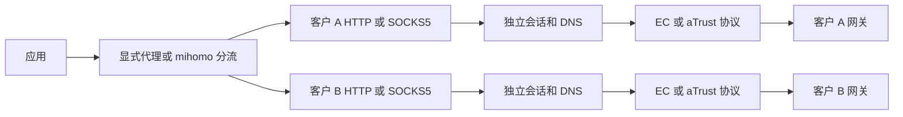

# EC 和 aTrust 精简客户端 fork 实施方案

本方案面向需要连接多个客户 VPN 的开发与运维场景。基于 zju-connect 的 Go 实现维护一个精简分支，集中提供 EC/aTrust 协议接入、认证交互和 HTTP/SOCKS5 代理；由上层软件负责应用选择、分流与系统流量接管。

第一版将原生二进制与 rootless Podman 容器列为两种正式部署方式，统一采用一实例一客户。多客户通过启动多个进程或多个容器实现，不在本次加入单实例多客户。配置统一使用 YAML；用户可选择记住密码，由系统凭据库或显式选择的加密存储保存，配置文件只记录策略与引用。移除系统 TUN、Shadowsocks 和浙大专用默认行为，保留协议必需的用户态网络栈、资源解析与 DNS。现有 docker-easyconnect 继续作为兼容性基线和回退路径。

状态：实施方案，2026 年 11 月 13 日。用户已确认开始实施并按阶段提交 Git。验收对象是当前由 EC 7.6.3、EC 7.6.7 和 aTrust 官方客户端覆盖的实际客户；这些版本名称用于划分测试场景，不作为新客户端的协议切换参数。

本次确认的范围调整：容器直接封装同一套核心编译出的 Linux 二进制。首版支持前台交互和由部署方提供的只读 secret 文件，不实现宿主凭据库与容器认证成功后保存密码的联动启动器。该启动器作为后续独立增量；原生安全记住密码仍属首版。镜像、入口、端口和卷属于部署配置，不另做一套协议、认证或会话实现。

## 目标与范围

第一版成功的标准是：客户能完成认证，通过指定代理访问实际业务；一个客户的故障不会影响另一个客户；流量不会因解析失败或协议不支持而悄悄直连；运行时无需主机网络管理权限。

| 能力 | 第一版处理 | 边界 |
|---|---|---|
| EC 与 aTrust 协议 | 保留并修复实际兼容问题 | 沿用 Go，不重写协议 |
| 现有认证方式 | 保留协议实现，统一交互接口 | 客户定制流程逐项验证 |
| HTTP 代理 | 保留 | 普通 HTTP 转发与 CONNECT 隧道 |
| SOCKS5 | 保留 TCP CONNECT | UDP ASSOCIATE 后续独立验收 |
| 用户态网络栈 | 保留 | 用于 VPN L3 隧道，不创建主机 TUN |
| aTrust TCP 和 L3 隧道 | 保留必要路径 | 按资源和网关能力选择 |
| 网关资源与内部 DNS | 保留 | 每客户独立，不替代上层业务分流 |
| 系统 TUN 与自动路由 | 删除 | 系统流量接管交给 mihomo 等上层软件 |
| Shadowsocks 与通用端口转发 | 删除 | 不参与 EC/aTrust 登录和隧道建立 |
| 浙大专用规则与默认服务器 | 删除 | 不自动加入校园域名或 10.0.0.0/8 |
| 主机 DNS 修改与 DNS 劫持 | 删除 | 保留代理内部解析能力 |
| 原生二进制与容器 | 两种正式部署方式 | 同一核心，一实例一客户；容器前台交互或 secret 文件注入 |
| YAML 配置 | 统一配置格式 | 严格校验，不存明文密码 |
| 记住密码 | 原生模式用户显式开启 | 系统凭据库优先，加密文件备用；宿主与容器联动延后 |
| 移动端封装与校园启动集成 | 移出首版构建 | 不影响原生 CLI 的正式支持 |
| 单进程多客户与管理平台 | 延后 | 首版依靠独立进程或容器管理 |

“保留各种认证”指保留上游已有实现并为新增流程预留接口，不承诺支持所有厂商插件、终端合规检查或客户定制单点登录。服务端下发的协议数据可以解析；不执行服务端下载的客户端程序或脚本。

## 架构与职责



TUN 是操作系统提供的三层虚拟网络接口；mihomo 是可通过 TUN 接收流量的代理和分流引擎。移除本客户端的 TUN 后，上层仍可使用 mihomo TUN 将流量导入 SOCKS5，但能力受整个代理链限制：TCP 通路不等于支持 UDP、ICMP 或任意 IP 转发。[mihomo TUN](https://wiki.metacubex.one/config/inbound/tun/)、[SOCKS 出站](https://wiki.metacubex.one/config/proxies/socks/)

上游普通代理模式使用 gVisor 用户态网络栈，TUN 模式则是另一个分支。因此裁剪时删除系统网卡、路由和相关集成，不能直接删除所有名称包含 stack、IPPool 或 FakeIP 的实现；内部域名映射可能仍被协议路径使用。[上游栈选择](https://github.com/Mythologyli/zju-connect/blob/5d7f5b11fcf231f72a0ec0d888bf0f2eadcce1da/main.go)

| 模块 | 负责内容 | 约束 |
|---|---|---|
| 协议适配 | EC/aTrust 握手、认证状态、资源和数据传输 | 尽量保持上游目录与实现，便于合入修复 |
| 会话管理 | 建连、等待认证、重连、关闭、状态保存 | 显式生命周期，不在库层退出整个进程 |
| 认证交互 | 输入密码、展示验证码、收集响应 | 协议层不直接读取终端或启动浏览器 |
| 代理监听 | HTTP 与 SOCKS5 | 所有业务连接绑定当前客户会话 |
| 解析与资源选择 | 客户 DNS、域名映射、网关资源匹配 | 缓存和映射不跨客户共享 |
| 凭据存储 | 保存、读取、更新与忘记密码 | 对接系统凭据库或 age 文件，不自行设计加密格式 |
| CLI 与容器入口 | 参数校验、信号处理、终端展示 | 单实例运行，不内置容器编排器 |

## 认证交互设计

协议层通过统一交互接口发出 challenge，内容包括客户 ID、会话代次、challenge ID、类型、说明、图片或链接、服务端有效期，以及刷新和重发能力。交互层返回带相同标识的响应；过期或属于旧会话的响应必须拒绝。每个会话同一时刻只允许一个待处理 challenge。

| 类型 | 默认体验 | 降级与约束 |
|---|---|---|
| 用户名与密码 | 终端隐藏输入，按配置读取已保存密码 | 可开启记住密码，也支持只读 secret 文件注入 |
| 普通图片验证码 | 自动选择受支持的终端图片协议或 ANSI 彩色半块显示 | 允许强制渲染方式、打开原图；不依赖 OCR |
| 短信验证码 | 显示客户名和脱敏手机号，直接输入 | 区分短信主认证与密码后二次认证；重发受服务端间隔约束 |
| TOTP 或口令 | 提示后输入 | 用于生成 TOTP 的密钥作为独立 secret 管理 |
| 点选验证码 | 本机页面按顺序点选原图 | 正确换算坐标，支持清除与刷新；保留离线 JSON 输入方式 |
| CAS 与 OAuth2 | 打开受支持的认证链接并收集回调结果 | 先保留现有流程，不承诺任意身份提供方 |
| 客户端证书与设备确认 | 配置受保护的证书材料或展示确认提示 | 私钥口令不写日志，不自动绕过网关要求 |

普通 ASCII 字符画仅作降级方式。验证码的细笔画、颜色和干扰线可能因字符化丢失，因此必须允许随时查看原图。非交互环境不得在不可见的 stdin 上无限等待，也不得把验证码图片和响应写入常规日志。

点选页面在容器部署时采用明确的回环端口映射，避免使用容器内部随机端口而让主机无法访问。若启用本地回调，必须绑定单次随机令牌与 challenge，限制请求来源、请求体大小和有效期，用后销毁；不得承载任意命令或暴露会话凭据。离线导出图片与回填 JSON 作为零回调端口的备用路径。

第一版先完成前台交互。后台实例遇到二次认证时报告 waiting_auth，暂停业务可用状态并返回可识别退出状态或等待前台重启接管；进程管理器和 Podman 自动重启策略不得持续触发短信、密码重试或账户锁定。完整的后台 attach 认证通道作为后续增量，不作为第一版前提。

会话状态建议为 idle、connecting、authenticating、waiting_auth、ready、reconnecting、stopping、failed。传输中断可以指数退避并加入随机抖动；认证拒绝、需要人工确认和凭据错误不得无界重试。重连成功不代表原有 TCP 连接可无损恢复，旧连接应被正确关闭。

## 代理与 DNS 行为

每个监听端口明确代表一个客户。业务请求进入客户 A 的端口后，只能经客户 A 的会话访问；会话不可用、资源不支持、DNS 失败或地址族不支持时，返回错误。网关与认证服务器连接使用独立的基础网络拨号器，这类控制连接不受业务代理入口规则限制。

这需要修改上游的部分默认行为：现有 dialer 包含针对未匹配资源、IPv6 和部分解析失败情况的直连路径。精简版删除业务直连兜底，同时保留网关下发资源所要求的访问限制、应用标识和节点选择。[当前 dialer](https://github.com/Mythologyli/zju-connect/blob/5d7f5b11fcf231f72a0ec0d888bf0f2eadcce1da/dial/dialer.go)

域名解析分为两条独立路径：连接 VPN 网关及必要认证端点时使用基础网络解析；通过代理请求的业务域名使用当前客户的资源映射和 VPN 内 DNS。业务解析失败默认报错，不回退到公共 DNS。网关未提供 DNS 时，允许配置经该 VPN 可达的解析器；只有 IP 的业务不强制要求 DNS。

SOCKS5 客户端应传递域名，例如使用 socks5h；HTTP 入口保留目标主机名。内部名称在到达代理前就被上层解析为 IP 时，代理无法恢复原始域名。mihomo 需要同时考虑域名传递和客户 DNS；第一版不增加独立公共 DNS 监听来掩盖这个边界。

全局流量接管还需在上层排除 VPN 网关及必要认证端点，避免网关连接再次进入自身代理形成环路。VPN 网关是否允许访问公网取决于服务端资源策略，启用上层全局模式不能扩大网关授权范围。

## 部署方式与多客户运行

原生二进制和 rootless 容器使用相同协议核心、YAML schema 与代理行为。原生模式直接执行二进制，不要求安装 Podman；容器模式共享镜像。两者都保持一客户一实例，多客户分别启动进程或容器。每个实例使用独立配置、状态目录或卷、监听端口、DNS 缓存与凭据标识；同一状态目录不得被两个实例同时写入，启动时检测并拒绝冲突。单实例崩溃只影响该客户。

| 客户配置示例 | SOCKS5 主机端口 | HTTP 主机端口 | 原生状态目录或容器卷 |
|---|---|---|---|
| customer-a-ec | 21080 | 21081 | A 独立目录或卷 |
| customer-b-ec | 31080 | 31081 | B 独立目录或卷 |
| customer-c-atrust | 41080 | 41081 | C 独立目录或卷 |

以上沿用试用包端口分配，启动前检查占用；现有 docker-easyconnect 的镜像、容器、端口和状态不自动修改。同账号可能受网关单会话限制，比较新旧客户端时应交替登录；不同客户可并行。

原生模式以当前普通用户运行，默认监听 127.0.0.1，不创建 TUN、不修改系统路由或系统 DNS；它与当前用户共享主机文件与网络访问权限，因此不能声称拥有容器同等的隔离边界。原生发布面向 Windows、Linux 和 macOS，按已完成构建与运行验收的平台和架构发布。容器模式使用 rootless Podman、只读根文件系统、删除 capabilities、禁止提权和独立状态卷；不挂载宿主机目录、容器 socket 或 /dev/net/tun。容器内可监听 0.0.0.0，主机端口只发布到 127.0.0.1。

客户 A 和 B 可以都存在 10.0.0.10，独立代理端口可以区分去向。若它们连域名也相同，上层仅凭目的地址无法判断客户，必须通过应用、入口或人工选择区分；不能把两个客户的 DNS 缓存合并。第一版不实现跨客户自动选择算法。

当前上游有全局配置和退出钩子，且部分底层路径可以终止进程；直接在一个进程内并发创建多个客户端会扩大故障影响。因此先让核心代码拥有可关闭的实例接口，运行方式仍保持多进程。是否集中管理多个会话，待实际资源消耗与管理成本明确后再评估。

## 配置与命令约定

配置按客户连接、认证、凭据存储、监听、DNS、会话、TLS 分组，统一使用 YAML 文件（.yaml 或 .yml）。严格校验未知字段、重复键和字段类型，限制输入大小与别名展开，不执行自定义标签或任意对象构造。首版不兼容全部上游参数，也不保留 TOML 解析入口。以下字段和命令是拟定接口，不能用于当前上游或之前的试用启动器。

```yaml
schema_version: 1
id: customer-a
protocol: easyconnect
server: "vpn.customer.example:443"

auth:
  method: password
  username: "your-username"
  remember_password: true # 示例开启；默认 false

credentials:
  backend: auto # 原生模式选择系统凭据库，不自动降级到文件
  ref: customer-a-login # 非秘密标识，同时校验服务器与账户绑定

listen:
  socks5: "127.0.0.1:21080"
  http: "127.0.0.1:21081"

dns:
  mode: vpn
  servers: [] # 优先采用网关下发，也可显式指定 VPN 内 DNS

session:
  state_dir: "./state/customer-a"

tls:
  mode: verify
  ca_file: "" # 空值使用系统信任根
```

aTrust 使用 protocol: atrust，认证段增加由服务端发现的 domain。method 可选择 password、sms 或已实现的其他方式；sms 主认证使用 phone，不与密码后的短信 challenge 混为一谈。协议内部名称如 auth/psw 由适配层转换。YAML 不提供明文 password 字段；remember_password 默认为 false，配置文件只记录记住密码的选择、后端与非秘密引用。TOTP 种子、证书口令采用独立 secret，不由记住密码开关隐式保存。

拟定 CLI 包含 run --config、auth-info --config、config-check、version，以及 credentials status/set/delete --config；凭据命令只展示状态或提示输入，不提供输出明文密码的命令。示例运行形式为 vpn-client run --config customer-a.yaml，其中 vpn-client 是临时命令名。run 默认前台工作并支持 Ctrl+C；原生进程交给操作系统管理，容器交给 Podman 管理。状态输出不含凭据，明确区分“进程存在”“等待认证”和“业务就绪”。

协议兼容参数只为已复现的问题增加，每项需记录适用网关、默认行为与回归用例。优先自动协商；确实需要用户干预时放入 easyconnect 或 atrust 专属配置。禁止以恢复全部旧参数作为兼容捷径。

## 记住密码与安全存储

记住密码是按客户配置的显式选择，默认关闭。开启后，首次输入密码并完成该次认证链成功时，再写入选定后端；后续启动读取相同绑定的记录。存储失败必须提示“登录成功但密码未保存”，不能显示保存成功。密码或认证被拒绝时，不覆盖已有记录、不自动连续提交旧密码；用户可通过 credentials set 显式更新，也可通过 credentials delete 忘记密码。

remember_password: false 表示不自动读取或写入记住的密码，已有条目不会因手工编辑配置被悄悄删除；真正移除使用 credentials delete。删除记住密码与清除会话 Cookie/token 是两件事，分别提供明确操作，避免用户误以为忘记密码就等于退出全部会话。短信和图形验证码等一次性响应不持久化。

| 环境 | 首选保存方式 | 运行条件 |
|---|---|---|
| Windows 原生 | Windows Credential Manager 当前用户条目 | 以同一用户读取，不把密码传到子进程参数 |
| macOS 原生 | Keychain Services | 遵守系统访问控制与解锁提示 |
| Linux 桌面原生 | Secret Service，例如 GNOME Keyring | 需要可用的用户 D-Bus 会话与已解锁集合 |
| 无凭据服务的 Linux 或其他原生环境 | 用户显式选择 age 加密文件 | 启动时输入独立解锁口令 |
| rootless 容器 | 前台输入或部署方注入只读 secret 文件 | 首版不自动读写宿主凭据库；不向容器开放整个凭据库 |

系统后端使用标准接口，不自制密码混淆或密钥管理算法。Go 适配层统一提供 Get/Set/Delete/Status，但选库时检查各平台实现是否把密码放入命令行；macOS 优先使用 Keychain 原生 API，不使用携带密码参数的 security 子进程调用。backend: auto 仅选择当前平台的系统库；库不可用、锁定或拒绝访问时，明确报错或由用户选择本次不保存，不静默改用明文文件。[Windows 凭据 API](https://learn.microsoft.com/en-us/windows/win32/api/wincred/nf-wincred-credwritew)、[Apple Keychain](https://developer.apple.com/documentation/security/keychain-services)、[Secret Service](https://specifications.freedesktop.org/secret-service/latest/)

加密文件后端显式配置 backend: age-file 与 vault_file 路径，使用成熟的 filippo.io/age Go 库和标准口令加密格式，不自行拼装加密算法。文件仅保存密文，原子写入并限制权限；解锁口令通过隐藏输入获取，不放入 YAML、环境变量、argv 或与密文同目录的密钥文件。记住的是 VPN 密码，使用此后端仍需解锁口令；它不是无人值守方案。库的解密错误必须作为硬失败处理，读取完整文件并完成认证校验后才使用其中凭据，同时限制文件大小和解密资源消耗。[age Go API](https://pkg.go.dev/filippo.io/age)

容器首版直接运行同一 CLI，通过前台终端输入或配置中的 secret 文件路径获取密码。部署方可用 Podman secret 只读注入；secret 的创建、更新与删除由部署方负责，文档给出生命周期示例。Podman 默认 file driver 仅视为传递机制，不视为加密密码库。不把主机 D-Bus、Keychain、整个用户目录或凭据数据库挂进容器。配置和证书通过受控文件/secret 或专用命名卷提供，不挂载用户目录。

后续可增加轻量宿主启动器：复用原生凭据模块，通过 stdin 创建实例专用 Podman secret，在收到带实例和会话标识的认证成功事件后保存密码，并清理临时 secret。该联动不作为首版交付和验收条件。

每条记录绑定应用命名空间、客户 ID、协议、规范化服务器地址与端口、登录域和用户名；YAML 中的 ref 只是非秘密标识。任一身份字段变化时，不自动复用旧密码，要求重新输入或显式重新绑定。保留相同客户 ID 但换服务器，也不能把旧密码自动提交给新服务器。绑定与密码放在同一受保护记录中，不仅依赖可编辑 YAML。

需要无人值守时，使用在目标运行账户上下文中可访问的系统凭据库，或由部署方管理的外部 secret 文件注入；不把解锁口令写进脚本来绕过 age-file 的交互要求。计划任务、SSH 会话和系统服务可能无法访问桌面凭据库，必须作为部署条件单独验证。密码在认证时仍会短暂存在进程内存；尽量缩短存活时间，不承诺 Go 内存可被完全擦除。安全存储主要保护静态数据，不能抵御已控制该用户会话或进程的攻击者。

## 安全修复与发布

精简功能不自动修复 TLS、凭据处理或依赖漏洞。第一版必须同时处理以下事项，尤其是此前检查到的证书校验缺失和敏感会话日志。

| 项目 | 设计要求 | 验收证据 |
|---|---|---|
| 服务器身份 | 可用路径默认标准 TLS 校验；支持客户 CA 或经可信渠道获得的证书或公钥固定 | 错误 CA、主机名或固定值时拒绝连接 |
| 私有 TLS 兼容 | 分认证、控制与数据通道逐一落实校验 | 覆盖实际网关；不能仅删除 InsecureSkipVerify 后宣称完成 |
| 旧协议例外 | 确有必要时仅按客户显式启用并说明影响 | 不自动降级，不作为正式替换的默认配置 |
| 日志 | 密码、Cookie、TWFID、SID、token、SignKey 和认证响应脱敏 | 普通及调试日志均通过敏感字段测试 |
| 记住密码 | 系统凭据库或 age 加密存储；禁止明文降级 | 保存、读取、更新、删除、锁定与不可用后端测试 |
| 持久化 | 凭据与非秘密状态分离，原子写入、按客户隔离 | Linux 目录 0700、文件 0600；Windows 等使用对应访问控制；Cookie 与 token 同样按秘密保护 |
| 输入与资源 | 限制网关响应、验证码图像、解压数据和请求时间 | 超限或恶意数据不会无限分配或卡死 |
| 依赖与工具链 | 固定版本，更新受影响组件并扫描 | 源码与发布二进制报告，记录未解决项及可达性 |
| 发布来源 | 固定 CI Actions 提交、最小 token 权限、记录源提交 | 校验和、SBOM、构建来源证明和版本记录 |

服务器身份固定值不能从同一条未验证连接中取出后自动信任。aTrust 的现有 anti-MITM 与签名流程继续保留并纳入测试；它们与标准 TLS 校验的关系需逐通道确认。涉及 EC 旧密码套件时，应分别记录机密性和身份校验的限制。[EC 连接配置](https://github.com/Mythologyli/zju-connect/blob/5d7f5b11fcf231f72a0ec0d888bf0f2eadcce1da/client/easyconnect/client.go)、[aTrust TLS](https://github.com/Mythologyli/zju-connect/blob/5d7f5b11fcf231f72a0ec0d888bf0f2eadcce1da/client/atrust/tls.go)

原生模式遵循当前用户权限，容器模式进一步限制文件系统与进程等访问边界。rootless 不能消除共享内核、可达局域网服务、恶意网关响应或已获授权用户读取运行中凭据的风险。首版不承诺完整出站地址白名单，因为认证跳转和网关节点可能动态变化。

## 实施阶段与交付

| 阶段 | 工作与交付 | 进入下一阶段的条件 |
|---|---|---|
| P0 基线 | 固定当前源码、保留上游历史与许可证，运行测试，建立客户测试表，盘点 TLS 与敏感日志 | 可重复构建；实际 EC/aTrust 场景单独记录为外部验收门槛 |
| P1 运行闭环 | 严格 YAML、CLI、实例生命周期；删除系统 TUN、Shadowsocks、端口转发、校园默认值和无关集成；禁止业务直连及公共 DNS 回退 | HTTP/SOCKS5 和失败路径测试通过，无主机网络修改；IPPool 与内部 DNS 保留 |
| P2 认证交互 | 扩展已有 challenge 接口，完成终端图片、短信和点选流程、原生凭据后端及记住密码，修正重试与取消 | 过期、错误、取消及凭据增删改查通过；实际认证链在客户环境验证 |
| P3 安全收口 | 逐通道落实 TLS 校验、敏感日志保护和输入限制，完成有界恢复，更新并扫描依赖 | 无静默直连或 DNS 泄漏；安全例外明确；平台对应权限验证 |
| P4 多客户试用 | 原生二进制与轻量 rootless 镜像、独立配置与状态、secret 文件示例、mihomo 示例和回退文档 | 两种部署方式分别通过多实例与稳定性检查；容器不依赖宿主凭据启动器 |
| P5 首次发布 | 固定源码与构建链，产出资产、校验和、扫描报告和兼容列表 | 仅把已验证客户场景列为支持范围 |

日志脱敏、凭据保护和输入限制应从 P0 开始实施，不能等到 P3 才用于真实账户。每个阶段保留可运行提交，避免同时更换网络栈、重写认证并大幅调整目录。协议修复尽量保留为独立提交，方便与上游持续同步。

实施基线固定为当前仓库提交 8576e7a16076c4175d6dbe276573a353cf7260be，比最初候选 v1.3.1（5d7f5b11fcf231f72a0ec0d888bf0f2eadcce1da）多 14 个提交。复用已有 authchallenge、aTrust SetupContext/会话刷新和 EC TCP-only 网关支持，同时纠正新增底层退出进程等与目标冲突的行为。不直接追随浮动 main。维护上游来源和 AGPL-3.0 许可证信息，发布时保留对应源码、修改记录和许可证材料。[基线发布](https://github.com/Mythologyli/zju-connect/releases/tag/v1.3.1)、[许可证](https://github.com/Mythologyli/zju-connect/blob/5d7f5b11fcf231f72a0ec0d888bf0f2eadcce1da/LICENSE)

### 实现组织与提交节奏

保留 client/easyconnect、client/atrust、stack/gvisor、stack/tcptunnel 与协议解析结构。入口负责配置、信号和终端交互；实例管理层拥有客户端、解析器、网络栈及监听器。业务拨号器只持有当前 VPN 的访问能力；基础网络拨号器仅注入协议控制路径。库层返回错误或发布失败事件，退出码只由入口决定。

按可测试边界提交：方案与基线记录 → 业务拨号/DNS 禁止回退 → YAML 与精简 CLI/裁剪 → 生命周期与状态目录隔离 → TLS/日志/输入保护 → challenge 与凭据 → 镜像/文档/CI → 综合验收修正。每批提交前运行相关测试，结构性阶段运行全量测试与构建。协议兼容修复单独提交，提交记录不包含凭据、验证码或客户原始响应。

首版命令名为 tinyrill。run、auth-info、config-check、version 和 credentials status/set/delete 均使用严格 YAML；增加 session clear 用于单独清除持久会话状态。秘密通过交互、受保护后端或 secret_file 指定的文件输入，禁止 password、TOTP 种子、证书口令进入 YAML、argv 或日志。相对文件路径以配置文件目录为基准。配置错误、等待人工认证、认证拒绝和传输失败返回不同的可识别状态；后台认证不自动重发短信或重复旧密码。

认证挑战关联客户 ID、会话代次和 challenge ID，传入可取消 context。回调服务使用一次性令牌，校验 Host/Origin、方法、请求大小和期限。原生回调绑定回环地址；容器需要显式配置固定监听地址、宿主回环发布地址和端口，也可用导出图片/JSON 输入。原生凭据库不可用时明确报错，age-file 必须显式配置且交互解锁。

状态目录使用进程级独占锁，状态与秘密分离。记住密码关闭时不读取后端；密码仅在完整认证成功后自动保存；身份绑定包括客户、协议、规范化服务器、域和用户。重连创建新的会话代次及 DNS/资源状态，关闭原 TCP 连接。会话失效与人工认证不会触发无限重启。

真实客户网关、Linux/macOS 原生凭据服务及 rootless Podman 的运行验收需要相应环境。环境缺失时继续完成独立开发和可控测试，并明确列为未验收，不用模拟通过代替正式支持。

## 验收标准

| 类别 | 必测内容 | 通过条件 |
|---|---|---|
| 现有客户 | EC 7.6.3 场景、EC 7.6.7 场景、aTrust 场景 | 认证与实际业务逐项记录，不以登录成功代替业务可用 |
| 认证 | 图片、短信、点选、实际使用的其他方式；错误、过期、刷新和取消 | 响应对应正确客户与 challenge，无自动短信循环 |
| HTTP 与 SOCKS5 | 域名、IP、CONNECT、长连接、大文件和双向传输 | 两种入口均可用，错误可诊断，无凭据泄露 |
| DNS | 内部域名、网关 DNS 缺失、解析失败、同名客户域名 | 不跨客户命中缓存，不静默使用公共 DNS |
| 路径控制 | 未授权资源、不支持的 IPv6、会话断开、解析失败 | 明确失败；业务请求不从本地出口兜底 |
| 并发隔离 | 原生与容器模式分别至少三个实例并行，包含重复私网 IP | 互不串会话；终止 A 不影响 B、C |
| 恢复 | 临时断网、服务端下线、凭据过期、进程退出 | 有界退避，正确关闭旧连接，人工认证状态可见 |
| 稳定性 | 连续 8 小时业务、至少 60 分钟空闲后恢复 | 无持续资源增长；服务端空闲策略导致的失效可解释并恢复 |
| YAML | 未知字段、重复键、类型错误、过量别名、明文 password 字段 | 明确拒绝无效配置，不执行标签或输出秘密 |
| 凭据 | 系统库锁定或不可用、错误解锁口令、文件篡改、保存失败、改密和删除 | 无明文降级；错误可区分；旧凭据不被误覆盖 |
| 记住密码语义 | 开关关闭、服务器或账户改变、认证失败、存储失败 | 不自动读取关闭的记录，不复用错误绑定，状态提示真实 |
| 原生二进制 | 普通用户直接启动，多个独立进程，同目录冲突 | 无 Podman 依赖、无管理员权限需求，客户状态隔离 |
| 容器 | rootless、只读根、全部 capability 删除 | 无 TUN、NET_ADMIN、host 网络及主机路由修改 |
| 安全 | 错误证书、敏感日志、超大响应、依赖扫描 | 风险逐项处理或注明例外，例外客户不默认转正式使用 |
| 回退 | 停止新实例，恢复旧代理端口和登录 | 原 docker-easyconnect 配置和状态可继续使用 |

单元测试重点覆盖认证状态转换、资源匹配、DNS 与错误路径；协议解析使用脱敏固定样本，并增加畸形输入测试。端到端测试必须使用实际客户网关或可控等价环境；模拟测试和公开大学网关不能替代客户验收。

性能测试记录每实例及三实例合计的内存、CPU、吞吐和连接数，与相同主机、相同业务下的基线比较。第一版不预设未经测量的性能提升百分比。

## 风险与后续边界

最大的兼容风险是客户端版本号不能完整描述网关行为。同一版本也可能采用不同认证链、资源策略和终端校验，因此支持列表以客户网关能力和实测流程为单位。官方客户端能够通过下载组件改变行为的场景，需要新增协议实现，不能通过保留一个通用参数自动解决。

首版不纳入系统 TUN、Shadowsocks、透明代理、UDP ASSOCIATE、单进程多会话、Web 管理平台、宿主凭据与容器认证联动启动器和任意第三方认证插件。后续只有在实际业务提出需求并能提供测试环境时，才逐项增加。

开始实现时采用以下选择：Go、原生二进制与 rootless 容器双部署、一实例一客户、YAML 配置、用户可选的安全记住密码、无系统 TUN、HTTP 与 SOCKS5 TCP、终端优先认证、业务流量禁止直连兜底。项目名称和仓库归属可在建立仓库时确定；支持的平台与架构以实际发布验收结果列明。

在线方案页：https://chatgpt.com/space/page_93f3b82c3c288191b5f397574130ac52

